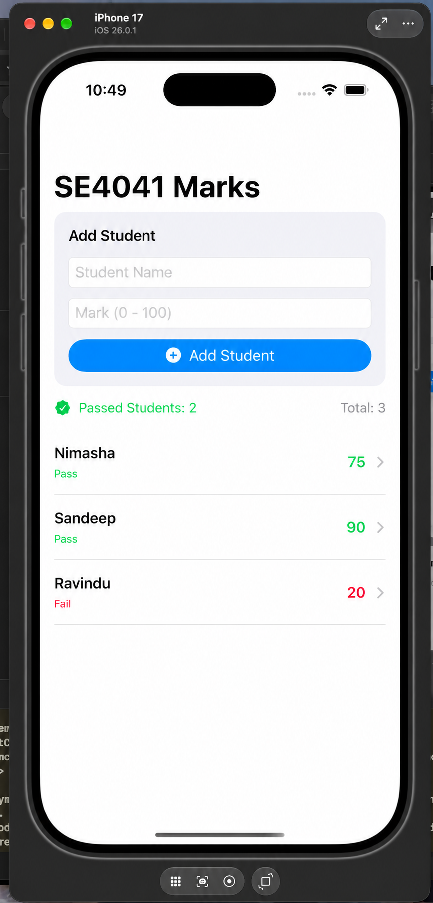
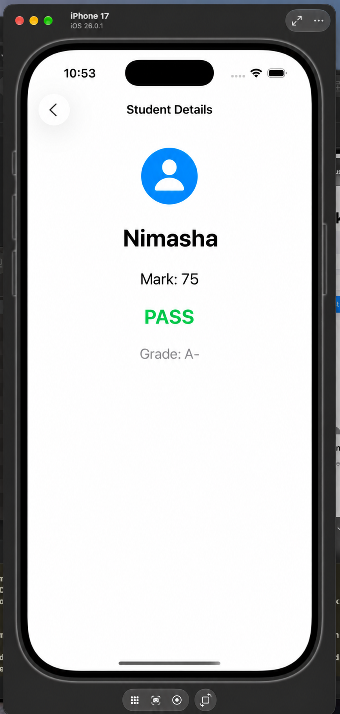

# SE4041 – Mobile Application Design & Development
## Practical 04 – SwiftUI Student Marks App

### Student Information
- **Student Name:** Himsara M.K.D.L
- **Student ID:** IT22274298
- **Module:** SE4041 – Mobile Application Design & Development
- **Practical:** Practical 04
- **Platform:** iOS
- **Programming Language:** Swift
- **Framework:** SwiftUI
- **Development Environment:** Xcode

### Application Screenshots

